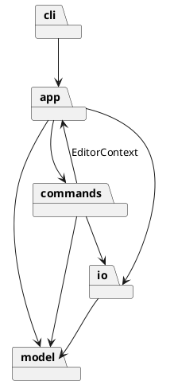

# Lab1 Phase 1：SVG CLI 编辑器

## 架构方案

### 工作方案与阶段验收

1. 工程与设计：初始化 TypeScript、严格类型检查和 Git；先写职责、依赖和验收边界。
2. 最小纵向流程：CLI → Command → 文档模型 → SVG 文件，浏览器能打开矩形。
3. 图形与编辑：六种类型、属性白名单、移动缩放删除、Command + 文档快照撤销。
4. 层级：创建时归属、分组/解组/迁移、同级顺序、循环检测与整棵子树恢复。
5. SVG 读写：XML 解析、缺 id 补全、往返保持、文件错误与历史屏障。
6. 验收交付：自动测试、典型会话、SVG 预览、依赖检查；更新文档，推送远端与最终 final tag。

每阶段单独提交，提交前至少通过该阶段相关验证。Git 提交身份及远程仓库地址由用户提供，不臆造作者身份；仅在完成验收、准备正式交付时打 final tag。

### 模块划分

| 目录 | 职责 |
| --- | --- |
| src/cli | 参数分词、逐行输入、交互提示与展示 |
| src/commands | 每类命令、命令注册表、编辑事务与历史 |
| src/model | 封装图形状态、图形多态、容器树、文档与工厂 |
| src/io | 文件接口与本地实现、SVG 编解码、XML 转义 |
| src/app | 文档会话、依赖装配和命令调用入口 |
| tests | 跨命令验收、模型边界、文件读写往返、真实进程测试 |

### 设计模式与落地

- Command：每条命令一个类，由注册表构造；编辑由历史管理器执行，查询不入栈，成功的文档 IO 设置历史屏障。
- Composite：Shape 为共同抽象，Group 内部持有 Shape 子节点；move/scale/set/delete 无须按标签判断具体图形。
- Memento：一条成功编辑保存前后文档快照。优先保障层级、顺序、属性及失败回滚的准确性；每次编辑耗时和历史内存约为 O(文档大小)。课程规模可接受，后续可替换为命令差量。
- Factory：只在 ShapeFactory 中按类型名选择具体图形类，读取和创建共享入口。
- IO 隔离：FileStore 接口隔离文件系统，测试可使用内存实现。

按名字分派仅允许 CommandRegistry（命令名）和 ShapeFactory（图形类型名）。这两处集中注册点标注为后续插件化阶段的待重构项，本阶段不提前构建插件系统。

### 依赖方向规则

- model 不依赖其他业务层、终端、文件系统或 XML 库。
- io 只依赖 model 和文件/XML 库；模型不负责序列化。
- commands 只使用 EditorContext、model 和 io，不接触终端或 Node 文件 API。
- app/EditorContext 为会话接口，不依赖命令；app/Editor 是装配和调用入口，可依赖 commands。
- cli 只依赖 app。main 为程序装配入口，可依赖 app、cli。
- tests 可依赖所有层。通过静态 import 检查脚本验证核心依赖方向。

### 变化点假设

| 变化点 | 本阶段安排 |
| --- | --- |
| 新图形类型 | Shape 多态与集中工厂注册；后续可改为 Provider 注册 |
| 新命令 | 独立 Command 子类与集中注册 |
| 图形界面或其他输入渠道 | 模型与命令不依赖终端，可复用 Editor 入口 |
| 文件存储位置 | FileStore 接口，当前仅本地文件 |
| 历史内存增长 | HistoryManager 集中快照策略，暂不做差量优化 |
| box 插件 | 不实现；保持普通 Group 递归组合能力 |

### 实现边界与解释

- group 的输入顺序不决定绘制顺序：选中节点按原文档深度优先顺序收入新组。跨父容器时新组放到第一个被选节点的原位置，其余节点迁入；该选择写入测试。
- front 移到兄弟数组末端（SVG 后画，视觉最前）；back 移到数组开头。
- 文档 IO 屏障清除旧历史并锁定 undo/redo；成功的新编辑解锁且开启新历史段。失败的 IO 不建立屏障。canvas 查询不建立屏障。
- CLI 仅整行以 # 开头为注释；颜色 #ffffff 正常解析。双引号支持空串、空格及转义的双引号、反斜杠。
- SVG 支持实验要求的六类图形及嵌套 g；不承诺任意 SVG 的完整兼容。未知标签、无法表达的坐标变换必须明确报错，避免静默破坏。
- 尺寸/半径非负，画布尺寸为正；坐标允许负值，数值必须有限。缩放不改变 stroke-width 或字体大小，因为实验定义缩放全部几何属性。

## 过程记录

### 2026-10-22：启动与方案

- 用户先要求解读实验，再制定工作计划，随后授权按方案推进。
- 检查目录后发现仅有老师的 phase_cli_1.md，无已有源码或 AGENTS.md。
- 选择面向对象的 Command + Composite，并用快照降低复杂层级撤销的恢复风险。
- AI 方案自查：不能把整个实验当成一次大提交；不能将 box 误纳入本阶段；文件 IO 失败不能提前清空历史。
- 实施顺序修订：先建立完整的模型多态与四个模型测试，再接通 CLI 纵向流程。原因是容器顺序和克隆属于所有命令共享的基础，先验证可减少后续返工；模块职责没有变化。
- GitHub 账户经连接工具核对为 Luwarmth；用户随后明确提供提交邮箱。首条方案提交使用 GitHub 隐私邮箱，后续提交使用用户指定邮箱。
- 用户要求协助创建远程仓库，已创建私有仓库 https://github.com/Luwarmth/svg-editor-lab1 并回读确认归属与私有状态。

## 一致性自查

待实现结束后根据实际目录、依赖检查结果和修订记录填写。

## 质量保证手段

计划使用严格 TypeScript 检查、Node 内置测试运行器、实际 CLI 子进程会话、SVG 保存/读回对比、浏览器视觉检查及模块依赖检查。最终记录实际结果，不将计划写成已完成。
